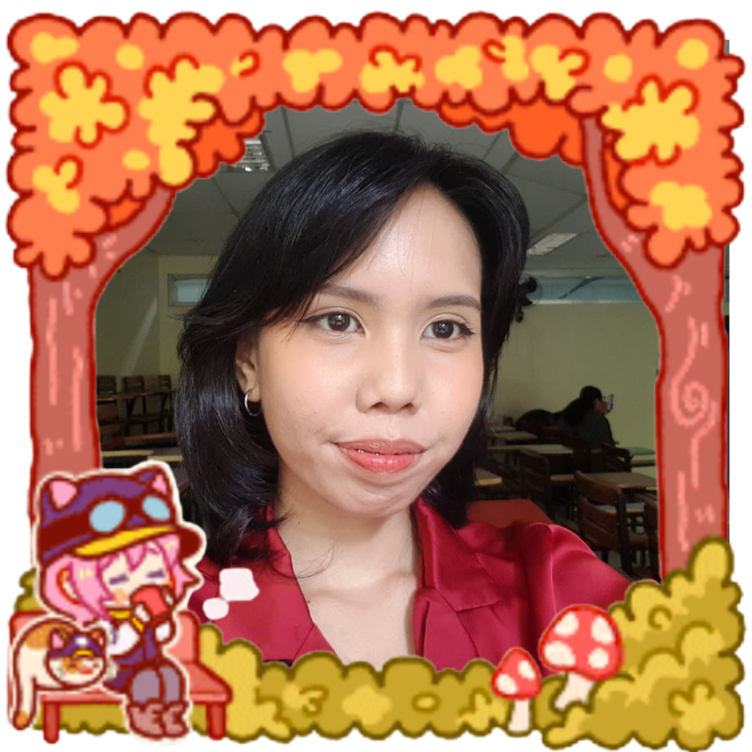
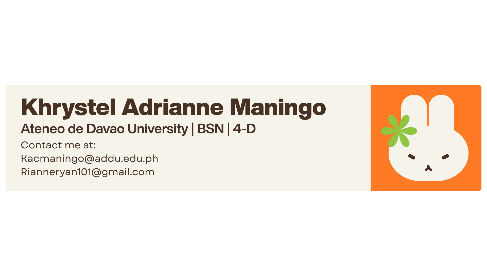

<!-- Waving Header Banner -->

<table>
  <tr>
    <td width="40%" align="center">
    ㅤ
       
         
<small> 
  ㅤ
  
**Khrystel Adrianne C. Maningo**   
🎓AdDU | BSN-4D   
📍Davao City, PH   
ㅤ
</small>
    </td>
    <td width="60%" valign="justified">

  

Hi! I'm Khrystel, a fourth-year BS Nursing student at Ateneo de Davao University. While I'm pursuing a career in healthcare, I also enjoy exploring my creative side through digital design, animation, and technology.

Outside of academics, I love spending my free time gaming with friends, reading, and working on arts and crafts. I enjoy anything that allows me to express my creativity and have fun along the way. And if you couldn't already tell from the theme of this repository, I absolutely adore bunnies and the color orange! 🐰🧡 

</table>

---

  
# 🐰 About the Portfolio 🐰

 
  *Welcome to my repository!✨*
 
 This is a collection of my work and experiences from class 99-040. Explore the projects, activities, and insights that reflect my learning and growth throughout the course.
>

# 🧡 My Showcase

  
> *‼️Click on the titles to be redirected to the activity‼️*
  
  
 

  
|  |  |  |
| :---: | :---: | :---: |
| **🎨DESIGN PRINCIPLES** | **®️BRANDING CREATION** | **📃INFOGRAPHIC & PROJECT DOCUMENTATION** |
| Focuses on applying core visual design principles to improve layout structure and clarity. | Explores the process on brand identity creation, including its logo, tagline, icons, color palette, typography, and business card.. | Features a one-page infographic simplifying a real-world issue alongside project documentation. |

 

<!-- Prelim Video Presentation Banner -->

---

 

<!-- Midterm PPT Presentation Banner -->
|  |
| :---: | 
|**🎤GOOGLE WORKSPACE PRESENTATION**|
|  explores the use of digital tools for document creation, organization, and collaboration. It highlights how technology improves communication, teamwork, and productivity through efficient sharing, editing, and management of information. |

---

 

  
|  |  |  |
| :---: | :---: | :---: |
| **🤖AI TOOLS** | **🖥️WEBSITE CREATION** | **📄RESUME GENERATION** |
| Explores how effective prompt engineering improves AI-generated outputs. It highlights the importance of clear and specific instructions in achieving accurate and useful results. | Demonstrates how a well-structured prompt can transform creative ideas, branding elements, and design preferences into a functional and visually appealing website. | Explores the use of different artificial intelligence tools to generate and improve digital content. |

